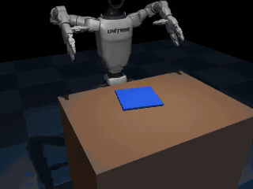
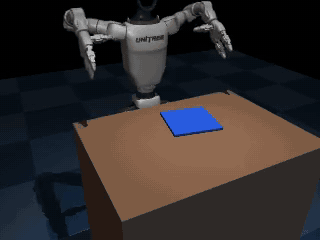
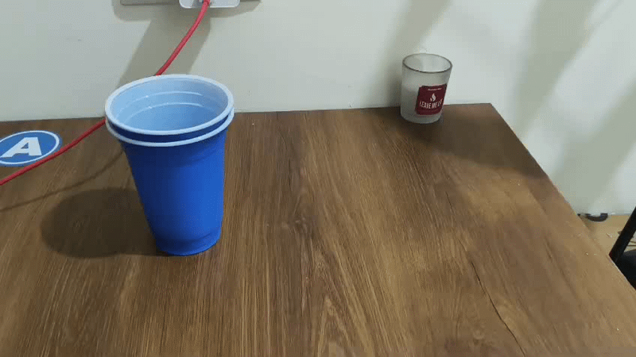

# ContactBC

Egocentric human video driving a Unitree G1 (Dex3-1 hands) in MuJoCo. Pipeline: video, hand tracking, retargeted robot motion, physics replay with contact-verified labels, MimicGen-style augmentation, behavior cloning, RL fine-tuning.

Submission for "Teach a Humanoid With Your Own Hands".

| human strokes replayed on the G1 | learned policy (BC + RL), held-out cloth pose | learned policy failure |
|---|---|---|
|  |  |  |

### Human demonstration

The source human video that drives the robot, shown as GIFs.

Human demo 1:




## Contents
- [Overview](#overview)
- [Architecture](#architecture)
- [Repository structure](#repository-structure)
- [Installation](#installation)
- [Data](#data)
- [Usage](#usage)
- [Design choices](#design-choices)
- [Results](#results)
- [What worked, what didn't, assumptions](#what-worked-what-didnt-assumptions)
- [Appendix](#appendix)
- [License](#license)
- [Acknowledgements](#acknowledgements)

## Overview

Two tasks share one pipeline:

- v2: two-handed cloth folding. 157 egocentric T-shirt-folding videos drive both G1 arms to fold a cloth in half.
- v1: cup on a coaster, single hand, 7 videos.

I did not have phone recordings of my own when I built this, so the human data is egocentric video from Apple's EgoDex dataset (Vision Pro, head-mounted, 30 fps). The pipeline can take phone video (see [Using your own phone takes](#using-your-own-phone-takes)), but every result below uses EgoDex.

Main results:
- Augmentation is what makes BC generalize to new object poses: 0% to 28% on the cup, 0% to 11% on the cloth.
- My original idea, upweighting the BC loss near contact transitions (the "Contact" in ContactBC), did not help on either task.
- The cloth policy is weak (best 14% success). The pipeline runs end to end, though.

## Architecture

1. Perception: MediaPipe hand landmarks and finger angles. Wrist pose from EgoDex's ARKit tracking (or PnP for phone video).
2. Retarget and replay: human segments are warped to the scene objects and run on the G1 with IK and closed-loop re-aiming. Success is decided from contact forces and object state.
3. Augment: random object poses plus random human strokes, keep only verified successes.
4. Learn: MLP behavior cloning on replays plus augmented episodes. For the cloth task, a PPO residual on top.
5. Evaluate: 50 rollouts per training seed on poses from an RNG seed never used for data generation.

## Repository structure

```
fetch_data.py extract_hands.py retarget.py scene.py ik.py replay.py augment.py train_bc.py eval.py run.sh verify_env.py
fold/          v2 cloth folding (fetch, extract, retarget, scene, replay, augment, bc, rl, eval, phases)
data/sample/   derived sample data (MediaPipe output for ep217, one replay, one augmented episode, stats)
outputs/       results.md/json, replay_results.json, augment_summary.json, gifs/
assets/        figures
third_party/   mujoco_menagerie (sparse clone, not committed)
```

## Installation

Python 3.11, `MUJOCO_GL=egl` for headless rendering.

```bash
git clone https://github.com/shiv207/ContactBC.git
cd ContactBC
./run.sh            # venv, Menagerie, data, full v1 cup pipeline (~15 min after downloads)
fold/run_fold.sh    # v2 cloth folding (~2.5 h on RTX 5060 + 24 cores)
```

On RTX 50xx (sm_120) torch must be the CUDA 12.8 build; `run.sh` handles it. MediaPipe 0.10.21 needs Python 3.12 or older. Tested on Arch Linux with an RTX 5060.

## Data

Source: [EgoDex](https://arxiv.org/abs/2505.11709) through the LeRobot conversion [`griffinlabs/EgoDex-LeRobot-v3.0`](https://huggingface.co/datasets/griffinlabs/EgoDex-LeRobot-v3.0).

- v1 cup: every "pick up the {tea cup / cup} from the table and place it on/in {bowl / tray / case}" episode in the `basic_pick_place` test split. 7 takes, 1.7 to 3.3 s each, five different people. The coaster in sim stands in for the bowl or tray.
- v2 cloth: `basic_fold`, 77 test + 80 train takes, cut to H.264 clips. 120 of the 157 takes contain a detectable bimanual stroke, 298 strokes in total.

EgoDex is CC-BY-NC-ND 4.0, so I don't redistribute the footage. `fetch_data.py` and `fold/fetch.py` download it. `data/sample/` has only things I derived from it: landmarks, finger angles, one replayed episode, one augmented episode, extraction stats. Per-take list in `data/README.md`.

### Using your own phone takes

Put `*.mp4` files (any name not starting with `ep`) in `data/raw/takes/`, then:

```bash
python extract_hands.py
python replay.py --wrist-source mediapipe
python augment.py --wrist-source mediapipe
```

The extractor assumes about 60 degrees horizontal FOV, a static and roughly level camera, and no ground truth. Hold the phone at chest height pointing at the table, use the right hand, record one pick, place, retreat per take, and keep the cup visible at the start.

## Usage

### v2: cloth folding

| step | script | what it does |
|---|---|---|
| data | `fold/fetch.py` | EgoDex `basic_fold` clips |
| hands | `fold/extract.py` | MediaPipe on both hands (detected in 66% / 50% of frames, left / right), finger angles, aperture, ARKit wrist poses |
| strokes | `fold/retarget.py` | finds bimanual fold strokes (both wrists lift together, move at least 5 cm, set down), warps each so the grasp lands on the near corners and the release over the far corners |
| scene | `fold/scene.py` | fixed-base G1 with two Dex3 hands, 9x9 flex cloth (20x20 cm), both arms by IK |
| replay | `fold/replay.py` | closed-loop re-aiming. Success: both near corners within 5 cm of the far corners, fold error under 7 cm, grasp held for 90% of transport, released. 148/298 succeed |
| augment | `fold/augment.py` | random cloth pose + random stroke, keep verified folds: 504 episodes (about 43% kept) |
| BC | `fold/bc.py` | MLP 3x512. Obs: 28 joints, 4 cloth corners, grasp flags, phase. Predicts 10-step chunks of joint deltas, temporal ensembling |
| RL | `fold/rl.py` | PPO residual (up to about 3 cm) on the frozen BC commands, 25 iterations x 80 episodes |
| eval | `fold/eval.py` | 50 held-out rollouts per seed |
| phases | `fold/phases.py` | unsupervised HMM check |

### v1: cup on a coaster

| step | script | output |
|---|---|---|
| 0 | `fetch_data.py` | `data/raw/takes/ep*.mp4` |
| 1 | `extract_hands.py`: MediaPipe, 21 landmarks, Savitzky-Golay, wrist pose, finger angles | `data/processed/*.npz` |
| 2 | `retarget.py`: wrist path + finger angles to G1 arm (IK) and Dex3 joints, clipped to limits | library + summary |
| 3 | `scene.py`: G1 + Dex3, table, cup, coaster, fingertip touch sensors, front and ego cameras | `outputs/scene_*.png` |
| 4 | `replay.py`: replay, log fingertip forces, label success/fail, GIFs | `data/demos/`, `outputs/gifs/replay_*` |
| 5 | `augment.py`: randomize cup/coaster, warp takes, keep contact-confirmed successes | `data/augmented/` (500) |
| 6 | `train_bc.py`: MLP BC, 5 variants x 3 seeds | `checkpoints/` |
| 7 | `eval.py`: 50 rollouts per variant per seed | `outputs/results.md`, `outputs/gifs/eval_*` |

## Design choices

Robot. `unitree_g1/g1_with_hands.xml` from MuJoCo Menagerie. The hand is the Dex3-1: 3 fingers (thumb, index, middle), 7 DoF, so the human ring and little fingers are dropped. Menagerie has no five-finger G1 and I kept Dex3 rather than swap in a floating Shadow or Leap hand. The pelvis is welded to the world. Position targets at 30 Hz with 17 physics substeps of 2 ms.

Hand extraction. MediaPipe on every frame. In unmirrored egocentric video the wearer's right hand is labelled "Left". The 21 world landmarks and the 2D landmarks are gap-filled and smoothed with Savitzky-Golay (window 9, order 3). I compute 15 finger angles plus a normalized thumb-index aperture. Monocular wrist pose comes from `solvePnP` lifted with the head pose, and I validate all of it against the EgoDex ARKit skeleton (`assets/mediapipe_vs_egodex.png`).

Retargeting (v1):
1. The human wrist path is yaw-aligned to the wearer's heading, slowed 2x, and split at the grasp keyframe (motion onset) and release keyframe (speed valley).
2. Object-centric warp, as in MimicGen: transport is expressed relative to the cup and warped so the release keyframe lands above the coaster. The retreat is expressed relative to the coaster. Each take keeps its own lift height, path shape and timing.
3. Finger flexion is mapped linearly per joint to Dex3 and clipped to limits. Between grasp and release the hand is locked to a holding closure.
4. Damped-least-squares IK onto the `grasp` site, warm-started per frame, fixed side-grasp wrist orientation.

Success labels (v1). Grasp held: at least 2 fingertip links touching the cup for at least 80% of transport, cup lifted at least 2 cm. Placed: cup center within 4 cm of the coaster center, upright (cos tilt above 0.95), resting, not touched.

BC:

| | v1 cup | v2 cloth |
|---|---|---|
| network | MLP 3x256 | MLP 3x512 |
| obs | 26-D: 14 joints, cup position, cup up-axis, coaster xy, fingertip touch, phase t/250 | 28 joints, 4 cloth corners, grasp flags, phase |
| output | 10-step chunk of joint-target deltas, ACT-style temporal ensembling | same |
| contact-gated loss | frames within 6 steps of a finger-contact change weighted 8x (`cg-hand`: finger dims only) | finger dims, 8x |

Cloth grasping is a weld, not friction. When a Dex3 hand is commanded closed within 4 cm of the cloth, a point constraint attaches the fingertip to the nearest cloth vertex, and opening releases it. The cloth collides only with the table and the fingers pass through it. This is the biggest shortcut in v2.

## Results

50 closed-loop rollouts per training seed on randomized poses. Files: `outputs/fold_results.md`, `outputs/results.md`.

### v2: cloth folding

Cloth pose randomized: center +-2/+-5 cm, yaw +-15 degrees.

| variant | training | success | grasp held | final corner error | per-seed success |
|---|---|---|---|---|---|
| `plain` | BC on 148 direct human replays | 0 +- 0% | 0.03 | 20.2 cm | 0/50, 0/50, 0/50 |
| `aug` | BC on 148 replays + 504 augmented | 11 +- 2% | 0.52 | 15.0 cm | 5/50, 5/50, 7/50 |
| `aug+cg` | same + contact-gated loss (finger dims, 8x) | 11 +- 6% | 0.57 | 13.5 cm | 5/50, 9/50, 2/50 |
| `aug+rlv1` | `aug` + PPO residual, corner-distance reward | 6% | 0.54 | 16.4 cm | 3/50 (seed 0 only) |
| `aug+rl` | `aug` + PPO residual, grasp-aware reward | 14 +- 4% | 0.52 | 15.4 cm | 10/50, 5/50, 6/50 |

- The human strokes replayed with the planner fold the cloth in 50% of cases (148/298). The best learned policy folds about 1 rollout in 7.
- RL helped at most a little. With the grasp-aware reward, seed 0 doubled its BC base (10/50 vs 5/50), seeds 1 and 2 did not (5 vs 5, 6 vs 7). 14 +- 4% vs 11 +- 2% is within noise.
- Most common failure: the policy never grasps (41% of `aug` rollouts). It hovers above the cloth and never commits to the descent. 16% drop the cloth mid-fold, 32% hold it but misplace it.

### v2: unsupervised phase check

I fit a Gaussian HMM on human strokes only, with no labels (298 strokes, 39k frames), using wrist height, wrist speed and MediaPipe pinch aperture. BIC picks 5 states: low/open (reach, release), low/pinched (grasp, set-down), mid-height moving x2 (lift, lower), lifted/carry.

What held up:
- The grasp and release keyframes I designed for retargeting fall a median 5 frames (0.17 s) from an HMM boundary. Random boundaries are 9 frames away.
- Robot rollouts decoded with the human HMM separate by outcome. Successful folds spend 17% of their time in "lifted" (humans: 14%), failures spend 64%, because they hover. Same split for `aug+rl` (39% vs 77%).

What didn't:
- The strict phase-order test (pinch before lift-off, open after set-down) holds in only 35% / 32% of human strokes, because MediaPipe's aperture is noisy with fingers buried in cloth. No robot rollout passes it either.
- Robot and human phase profiles don't match overall. The robot is higher and slower (10 cm minimum fold clearance, 2x slowdown).


### v1: cup on a coaster

3 training seeds per variant.

| variant | training data | contact-gated loss | success | grasp held | placed | per-seed success |
|---|---|---|---|---|---|---|
| `plain` | 3 direct human replays | no | 0 +- 0% | 0 +- 0% | 0 +- 0% | 0/50, 0/50, 0/50 |
| `plain+cg` | 3 direct human replays | yes (all dims) | 0 +- 0% | 1 +- 1% | 0 +- 0% | 0/50, 0/50, 0/50 |
| `aug` | 500 augmented episodes | no | 28 +- 3% | 83 +- 5% | 29 +- 2% | 13/50, 13/50, 16/50 |
| `aug+cg` (ContactBC) | 500 augmented episodes | yes (all dims) | 14 +- 2% | 75 +- 5% | 15 +- 1% | 7/50, 6/50, 8/50 |
| `aug+cg-hand` | 500 augmented episodes | yes (finger dims) | 22 +- 6% | 71 +- 2% | 23 +- 7% | 10/50, 8/50, 15/50 |

- Direct replay of the 7 human takes at the nominal scene: 3/7 succeed.
- Augmentation produced 500 contact-confirmed successes out of 2,129 trials (23.5%). Per source take: ep128 48%, ep016 34%, ep202 29%, ep217 28%, ep237 16%, ep270 10%, ep062 0%.
- The bottleneck is placement. Policies hold the cup in 70 to 83% of rollouts but place it upright on the coaster in only 15 to 29%.

MediaPipe vs EgoDex ARKit ground truth (median over takes):

| measure | result |
|---|---|
| right hand detected | 63% of frames |
| 2D wrist error | 39 px at 960x540 |
| monocular 3D wrist error (PnP) | 20 cm |
| finger flexion error | 23 degrees |
| thumb-index aperture correlation | r = 0.10 |

| direct replay of a human take (ep217) | learned BC policy (`aug`, held-out pose) | learned policy failure |
|---|---|---|
|  |  |  |

## What worked, what didn't, assumptions

### Worked
- Retargeting to Dex3 grasps. Once the contact geometry was worked out in the wrist frame, all 7 cup takes produce a grasp that holds through transport.
- Object-centric warping. 7 human takes became 500 verified successes in about 3 minutes on 20 CPU workers, and it is the one change that made BC generalize.
- Labelling from physics contact instead of from the plan, so no failed grasp ends up in the training set.
- Action chunking plus a phase feature in BC: 4% to 28% on the cup task.

### Didn't
- The contact-gated loss. Cup: 14% vs 28%. Cloth: 11% vs 11%. Grasp and release frames were already the easiest part for the policy, and upweighting them starved the transport and placement frames where it actually fails. My guess, untested, is that it matters more when grasps are noisier (a real robot, a heavier cup).
- Monocular 3D wrist from MediaPipe. PnP depth is off by 8 to 24 cm, so the wrist path comes from EgoDex's ARKit tracking. MediaPipe only supplies finger angles. `--wrist-source mediapipe` is there for phone video but I haven't validated it end to end.
- MediaPipe finger angles on small cups are noisy (about 23 degrees error, aperture r around 0.1), so the hand is locked to a holding closure during grasp.
- EgoDex clips start at contact, so there is no human reach. I prepend a canonical reach. Using the human's closed-grasp preshape knocked the cup over.
- Human retreat motions don't transfer to Dex3. Its thumb sticks out sideways and hooks the cup, so the hand first backs off along the finger axis.
- 4/7 direct cup replays fail at the nominal scene. In ep062, ep237 and ep270 the cup tips during or right after release, and ep202 is carried past the coaster. ep062 never succeeds in 300 augmentation trials.
- Cloth RL. The corner-distance-only reward made it worse (6%). The grasp-aware reward gave a small gain that is within noise.
- Cloth data. Half the strokes (150/298) fail even under the planner and I did not categorize why. Not every human stroke is a fold in half: people also smooth, lift and turn the shirt.

| failed direct replays | | | failed BC rollouts | |
|---|---|---|---|---|
|  |  |  |  |  |
| ep062: cup tips at release | ep237: knocked over | ep202: carried past the coaster | `plain`: no generalization | `aug+cg`: grasps, misses the place |

### Bugs that cost the most time
- MuJoCo `connect` constraints anchor body2 at compile time from the zero pose, so welds held the cloth 20 cm off. Fixed by zeroing the body2 anchor.
- The reset cleared all equality constraints, including the cloth's own edge constraint, so the cloth fell apart.
- Collision-unaware IK tucked the elbows into the torso. Fixed by limiting shoulder roll.
- BLAS threads oversubscribed 20 workers (load average 40 on 24 cores). Fixed with `OMP_NUM_THREADS=1`.
- The cup pivoted inside the 3-finger grasp until I added torsional friction (`condim=6`). Over-squeezing flung the cup on release, so closure is capped. A weak IK orientation weight let the wrist rotate up to 12 degrees near the table.

### Assumptions and simplifications
- The human data is EgoDex, not my own recordings.
- Fixed-base G1, no balance control.
- Fixed wrist orientation: side grasp for the cup, fingers pitched 45 degrees down for the cloth (75 degrees was out of IK reach).
- The reach and the 8 cm lift on retreat are scripted. The human data supplies stroke timing, lift profile, path shape and left/right coordination. A 10 cm minimum clearance is enforced mid-fold so the near half flips over.
- Cloth grasp is a weld, the cloth collides only with the table, cloth self-collision is ignored (the metric is xy-based).
- Dex3's 3 fingers stand in for a 5-finger human hand.
- Not tried: SmolVLA, a five-finger hand, vision-based policies.

## Appendix

- Figures: `assets/mediapipe_vs_egodex.png`, `assets/fold_phases.png`, `assets/fold_rl_curve.png`
- Result files: `outputs/results.md`, `outputs/fold_results.md`, `outputs/replay_results.json`, `outputs/augment_summary.json`
- Per-take extraction stats: `data/sample/extract_stats.json`
- Papers: [EgoDex](https://arxiv.org/abs/2505.11709), [MimicGen](https://mimicgen.github.io/), VLM See, Robot Do (arXiv 2410.08792), Robot See Robot Do (arXiv 2409.18121)

## License

See `LICENSE` in the repo root. The EgoDex-derived samples are CC-BY-NC-ND 4.0 material, non-commercial use only.

## Acknowledgements

- [EgoDex](https://arxiv.org/abs/2505.11709) (Apple) for the egocentric data
- [MuJoCo Menagerie](https://github.com/google-deepmind/mujoco_menagerie) for the Unitree G1 model, and MuJoCo
- [MediaPipe Hands](https://github.com/google-ai-edge/mediapipe) for landmarks
- [MimicGen](https://mimicgen.github.io/) for the object-centric segment warping idea
- Armature AI Labs and Awign for the challenge
