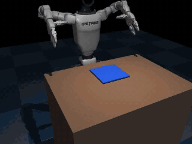
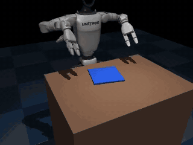
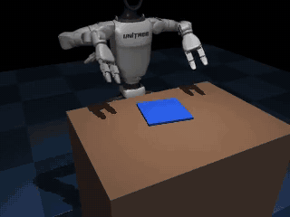
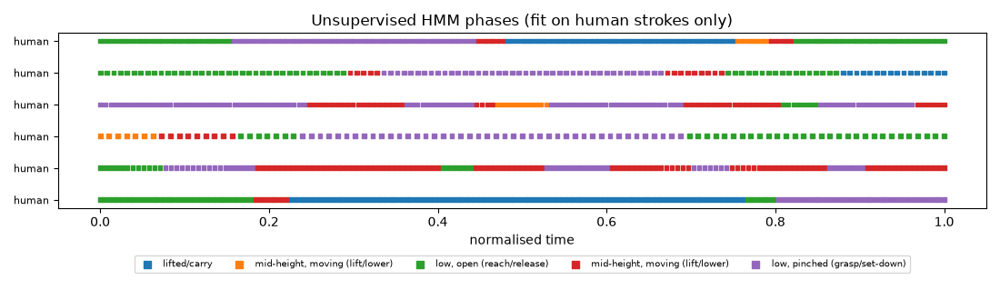
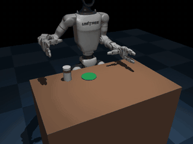
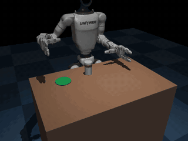
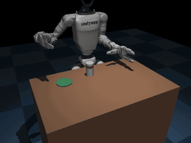

# ContactBC: teach a humanoid with egocentric human video

Egocentric (first-person) human videos drive a **Unitree G1 with Dex3-1 hands** in MuJoCo. The pipeline goes video →
hand tracking → retargeted robot motion → physics replay with verified labels → MimicGen-style augmentation →
behavior cloning → RL fine-tuning, with an unsupervised check on the learned behavior.

- **v2, two-handed cloth folding** (this section): 157 egocentric T-shirt-folding videos drive both G1 arms to fold a
  cloth in half.
- **[v1, cup on a coaster](#v1-cup-on-a-coaster)**: the first, single-hand version (7 videos).

| human strokes replayed on the G1 | learned policy (`dart+rel+self2+rec`), held-out cloth pose | learned policy failure |
|---|---|---|
|  |  |  |

## v2: bimanual cloth folding

### Results

> These are the first v2 results, on the original scene. The current best policy is `dart+rel+self2+rec`, at 81.3%
> on 450 held-out rollouts (`dart`: 77.6%);
> see [DART data and FineART-style subtask conditioning](#dart-data-and-fineart-style-subtask-conditioning) and the
> section after it.

`outputs/fold_results.md`: 50 closed-loop rollouts per training seed on randomized cloth poses (center ±2/±5 cm, yaw
±15°), drawn from an RNG seed never used for data generation.

| variant | training | success | grasp held (fraction of transport) | final corner error | per-seed success |
|---|---|---|---|---|---|
| `plain` | BC on 148 direct human replays | **0 ± 0%** | 0.03 | 20.2 cm | 0/50, 0/50, 0/50 |
| `aug` | BC on 148 replays + 504 augmented | **11 ± 2%** | 0.52 | 15.0 cm | 5/50, 5/50, 7/50 |
| `aug+cg` | same + contact-gated loss (finger dims, 8×) | **11 ± 6%** | 0.57 | 13.5 cm | 5/50, 9/50, 2/50 |
| `aug+rlv1` | `aug` + PPO residual, corner-distance reward | **6%** | 0.54 | 16.4 cm | 3/50 (seed 0 only) |
| `aug+rl` | `aug` + PPO residual, grasp-aware reward | **14 ± 4%** | 0.52 | 15.4 cm | 10/50, 5/50, 6/50 |

What this says:
- **The pipeline works end to end, but the learned policy is weak.** The best policy folds the cloth in about
  1 rollout in 7. The human strokes themselves, replayed with the planner, fold it in 50% of cases (148/298).
- **Augmentation is again what makes BC generalize.** BC on the human replays alone gets 0% on new cloth poses.
- **RL helped a little, at most, and not reliably.** With the grasp-aware reward, seed 0 doubled its BC base on the
  held-out set (10/50 vs 5/50), but seeds 1 and 2 did not improve (5 vs 5, 6 vs 7). The mean 14 ± 4% vs 11 ± 2% is
  within noise. The first reward (corner distance only) made things worse (6%). Training-time success stayed flat
  around the BC level (`assets/fold_rl_curve.png`).
- **Contact-gated loss: no effect** (11% vs 11%), consistent with v1.
- **Dominant failure: the policy never grasps** (41% of `aug` rollouts). It hovers above the cloth and never
  commits to the descent. 16% drop the cloth mid-fold, and 32% hold it but misplace it.

### DART data and FineART-style subtask conditioning

Later runs use the current scene (joint-rate limit, IK null-space posture) and count a flung cloth as a failure.
50 held-out rollouts × 3 seeds:

| variant | what changes | success | final corner error | per-seed |
|---|---|---|---|---|
| `dart` | BC on demos + augmented + 507 DART episodes (noise on the executed arm targets, clean expert labels) | **79 ± 4%** | 3.4 cm | 42, 37, 40 /50 |
| `dart+sub` | FineART hierarchy + knowledge insulation | **64 ± 4%** | 4.7 cm | 31, 30, 35 /50 |
| `dart+sub-ki` | FineART hierarchy, shared trunk (no KI) | **77 ± 5%** | 3.9 cm | 35, 41, 40 /50 |
| `dart+sub-t` | FineART hierarchy + KI, no clock input | **65 ± 5%** | 4.7 cm | 32, 36, 30 /50 |

**FineART method** ([arXiv 2609.36416](https://arxiv.org/abs/2609.36416), adapted to a state-based MLP in `fold/subtask.py` + `fold/bc.py`):
- Every demo frame gets a captioned subtask label: reach, descend, grasp, lift, carry, lower, release, retreat.
  The labels come from the planner's stage boundaries, so they are exact.
- A System-2 head predicts the current subtask from the observation. A System-1 head predicts the action chunk from
  the observation, System 2's features and a subtask embedding.
- Training uses teacher forcing (the annotated subtask) and the paper's loss weights, 10 × action MSE + 1 × subtask
  cross-entropy. At test time System 1 uses System 2's own prediction.
- Knowledge insulation (KI) passes System 2's features to System 1 through a stop-gradient.

**Result: no gain.** At best the hierarchy matches plain DART (77% vs 79%, within seed noise). With knowledge
insulation it is clearly worse (64%): the action head underfits, with about 1.7× the training MSE.
- **The subtask head is accurate on the training distribution but tracks time, not contact.** It is 99.5% accurate
  on training frames. In "never grasped" failures it still steps grasp → lift → carry with an empty hand, because no
  demo contains a missed grasp.
- **Knowing the subtask does not let the policy recover from a missed grasp.** That is the dominant failure mode
  here, and it needs recovery data, which this method does not provide.
- **The paper's gains came from elsewhere.** They came from language-specified spatial goals and human
  step-by-step guidance; neither exists in this single-goal task. The paper's own autonomous long-horizon result is
  0% for both arms.
- **Failure split over 150 rollouts:**
  - `dart`: 16 misplaced, 10 never grasped, 4 dropped.
  - `dart+sub`: 32 misplaced, 20 never grasped.
  - Most `dart` misplacements end 5.0–5.5 cm from the target, just over the 5 cm threshold.

Each eval rollout logs the policy's own subtask trace (`subtasks` in `outputs/fold_results.json`):

```bash
python fold/bc.py --variants dart+sub dart+sub-ki dart+sub-t --seeds 0 1 2
python fold/eval.py --variants dart dart+sub dart+sub-ki dart+sub-t
```

### Targeted fixes: hand-relative features, self-improvement, recovery demos

**Diagnosis first** (logging which vertex each hand welds to):
- **Grasp misses.** Every "never grasped" `dart` failure is one hand, usually the left, stopping 3–4 cm short of
  its corner when the cloth sits close to the body with positive yaw. IK reaches those corners to within 1 cm, so
  the error is the policy's, not a kinematic limit. The other hand then lifts the cloth by one corner, which is
  also what the "flung" failures are.
- **Misplacements.** These grasp the correct vertex and end 5.0–5.5 cm off, just over the 5 cm success limit.

Each fix below adds to the previous row; 50 held-out rollouts × 3 seeds:

| variant | adds | success | corner err. | per-seed |
|---|---|---|---|---|
| `dart` | baseline | **79 ± 4%** | 3.4 cm | 42, 37, 40 |
| `dart+rel` | grasp-site positions + offsets to the near and far corners, from forward kinematics (`fold/features.py`) | **75 ± 2%** | 3.7 cm | 36, 39, 38 |
| `dart+rel+self` | + 570 of the policy's own verified-clean folds on training poses (`fold/self_improve.py`, RECAP-style) | **80 ± 2%** | 2.9 cm | 40, 39, 41 |
| `dart+rel+self2` | + a second round (592 more) from the round-1 policies | **81 ± 4%** | 3.1 cm | 43, 41, 38 |
| `dart+rel+self2+q` | drop training episodes that ended > 3.5 cm off | **72 ± 9%** | 3.1 cm | 37, 30, 41 |
| `dart+rel+self2+rec` | + 300 recovery demos: one hand misses on purpose, reopens and re-grasps (`fold/recovery.py`) | **84 ± 6%** | 2.7 cm | 41, 46, 39 |

| `dart+rel+self2+rec2` | + 600 more recovery demos with randomized miss offsets, recovery frames oversampled to 30% of each batch | see below | | |

**Final comparison: 150 held-out poses × 3 seeds (450 rollouts per variant), paired by pose:**

| variant | success | one hand missed | misplaced | dropped | vs `dart` (pose-paired wins / losses, sign test) |
|---|---|---|---|---|---|
| `dart` | **77.6 ± 3.9%** (78, 78, 77) | 28 | 59 | 9 | |
| `dart+rel+self2+rec` | **81.3 ± 3.6%** (81, 80, 83) | 20 | 41 | 16 | 69 / 52, p = 0.15 |
| `dart+rel+self2+rec2` | **74.7 ± 4.0%** (73, 75, 76) | 22 | 56 | 28 | 60 / 73, p = 0.30 (and worse than `rec`, p = 0.005) |

Seed ensembles (`ens:`, the 3 seeds' action chunks averaged) on 150 poses: `ens:dart` 78.7%,
`ens:dart+rel+self2` 78.0%, `ens:dart+rel+self2+rec` 81.3%.

What this says:
- **Best policy: `dart+rel+self2+rec`, at 81.3% vs 77.6% (+3.7 points).** The gain is consistent across seeds
  (80–83 vs 77–78), and it misses fewer grasps and misplaces fewer folds. With 450 paired rollouts it is still not
  significant (p = 0.15). The 84% on 50 poses overstated it.
- **50 poses × 3 seeds was too small for these effects.** Its ±5% seed spread hid 3–5 point differences and made
  the 84% look like a clear win. Compare candidates on 150+ poses, paired by pose.
- **Hand-relative features fixed the targeted failure but added another.** Missed grasps fell from 6 to 2, but
  one-hand lifts that fling the cloth rose from 5 to 13. Self-improvement on verified-calm folds recovered that.
- **The policy did not learn the retry.** With recovery demos at about 11% of the data, policies almost never
  re-close a missed hand.
- **Oversampling recovery demos made it worse.** Oversampled to 30% of each batch (`rec2`), they didn't make the
  policy retry either: missed grasps stayed at 22 vs 20. Instead it dropped the cloth more mid-fold (28 vs 16), as
  if it had learned "open the hand" rather than "re-grasp after a miss". Learning a retry from demonstrations
  probably needs the miss state to look like the policy's own misses. RL could also do it, with a reward for
  regaining the grasp.
- **Quality filtering hurt.** Dropping the less precise DART episodes also drops the correction data, and one seed
  collapsed.
- **Seed ensembling did not help.** Averaging the seeds' chunks performs like a single seed.

```bash
python fold/bc.py --variants dart+rel --seeds 0 1 2
python fold/self_improve.py --variant dart+rel --round 1 --out data/fold_self_r1
python fold/bc.py --variants dart+rel+self
python fold/self_improve.py --variant dart+rel+self --round 2 --out data/fold_self_r2
python fold/recovery.py --target 300
python fold/bc.py --variants dart+rel+self2 dart+rel+self2+rec
python fold/eval.py --variants dart+rel dart+rel+self dart+rel+self2 dart+rel+self2+rec       # merges into results
python fold/recovery.py --target 600 --vary --seed 12 --out data/fold_recovery_vary
python fold/bc.py --variants dart+rel+self2+rec2
python fold/eval.py --variants dart dart+rel+self2+rec dart+rel+self2+rec2 -n 150          # final comparison
```

### Unsupervised phase check (`fold/phases.py`)

A Gaussian HMM is fit **on human strokes only, with no labels** (298 strokes, 39k frames). Per-frame features are
wrist height above the table, wrist speed, and MediaPipe pinch aperture, averaged over both hands. BIC chooses
**5 states**, which read as interpretable phases:

| discovered state | height | speed | aperture |
|---|---|---|---|
| low, open (reach / release) | 2.2 cm | 26 cm/s | 0.79 (open) |
| low, pinched (grasp / set-down) | 2.8 cm | 14 cm/s | 0.44 (closed) |
| mid-height, moving (lift / lower) ×2 | 6–7 cm | 26–46 cm/s | 0.39–0.56 |
| lifted / carry | 19 cm | 54 cm/s | 0.50 |

What it confirms, and what it doesn't:
- ✅ **The hand-designed keyframes are real phase boundaries.** The grasp and release keyframes used for
  retargeting fall a median **5 frames (0.17 s)** from an HMM low↔non-low boundary, against **9 frames** for random
  boundaries.
- ✅ **It separates robot successes from failures without labels.** Robot rollouts decoded with the human HMM
  (cropped to the same ±1 s window around grasp and release) differ sharply:
  - successful folds spend **17%** of their time in "lifted" (humans: 14%) and 29% in the low states;
  - failures spend **64%** in "lifted" and 11% low. They hover and never come down to the cloth, which matches the
    41% "never grasped" failure mode.
  - The same split holds for `aug+rl` (39% vs 77% lifted).
- ❌ **The strict phase order is not a reliable test.** "Pinch before lift-off, open after set-down" holds in only
  35% / 32% of human strokes: MediaPipe's aperture is noisy when fingers are buried in cloth. No robot rollout passes
  it either, because the Dex3 pinch looks nothing like a human aperture.
- ❌ **Robot and human phase profiles don't match overall.** Robot motion is systematically higher and slower: a
  10 cm minimum fold clearance and a 2× slowdown.



### Folding pipeline

```bash
./run.sh            # once: venv, Menagerie (and the v1 cup pipeline)
fold/run_fold.sh    # v2 folding, about 2.5 h on RTX 5060 + 24 cores
```

| step | script | what it does |
|---|---|---|
| data | `fold/fetch.py` | EgoDex `basic_fold`: 77 test + 80 train takes of egocentric T-shirt folding (Vision Pro, 30 fps), cut to H.264 clips |
| hands | `fold/extract.py` | MediaPipe on both hands (detected in 66% / 50% of frames, left / right). Finger angles and aperture, plus ARKit wrist poses. Aperture vs ARKit ground truth: r = 0.45 / 0.32 |
| strokes | `fold/retarget.py` | Finds bimanual fold strokes: both wrists lift together, move at least 5 cm, set down. **298 strokes from 120 takes**, median lift 7 cm, median travel 18 cm. Each is rotated so it points away from the body (mirrored if needed so left stays left) and warped so the grasp lands on the cloth's near corners and the release over its far corners, keeping the human lift profile and path shape |
| scene | `fold/scene.py` | Fixed-base G1 with two Dex3 hands, 9×9 flex cloth (20×20 cm) on the table, both arms by IK (elbow-out limited) |
| replay | `fold/replay.py` | Runs every stroke with closed-loop re-aiming at the current far corners. Success = both near corners within 5 cm of the far corners, fold error < 7 cm, grasp held ≥ 90% of transport, released. **148/298 succeed** |
| augment | `fold/augment.py` | Random cloth pose + random human stroke, keep verified folds only: 504 episodes (~43% kept) |
| BC | `fold/bc.py` | MLP 3×512. Obs: 28 joints + 4 cloth corners + grasp flags + phase. Predicts 10-step chunks of joint deltas with temporal ensembling |
| RL | `fold/rl.py` | PPO on a residual (≤ ~3 cm scale) added to the frozen BC arm commands. Reward: +1 per hand on first grasp, corner-progress shaping only while both hands hold, −1 for an early release, +3 for a verified fold. 25 iterations × 80 episodes |
| eval | `fold/eval.py` | 50 held-out rollouts per seed |
| phases | `fold/phases.py` | Unsupervised HMM check (above) |

### Simplifications and what failed (v2)

- **Grasping is a weld, not friction.** When a Dex3 hand is commanded closed within 4 cm of the cloth, a point
  constraint attaches its fingertip to the nearest cloth vertex. Opening the hand releases it. Pinching a 2 mm flex
  cloth off a table with fingertip friction was not reliable, and hand–cloth contact squeezed the flex into the table
  until it blew up. So **the cloth collides only with the table**, and the fingers pass through it. This is the main
  shortcut in v2.
- **Fixed wrist orientation:** fingers pitched 45° down. 75° (more natural) was out of reach: IK errors of 3–12 cm.
- **Pick/place is canonical; the human shapes the fold path.** The reach to the cloth (home → above the corner →
  descend) is scripted, as is the 8 cm lift on retreat. The human data supplies the fold stroke itself: timing, lift
  profile, path shape, and left/right coordination. A 10 cm minimum mid-fold clearance is enforced so the near half
  actually flips over.
- **Bugs that cost the most time, fixed:**
  - `connect` constraints anchor body2 at compile time from the zero pose, so welds held the cloth 20 cm off; fixed
    by zeroing the body2 anchor.
  - The reset cleared *all* equality constraints, including the cloth's own edge constraint, so the cloth fell apart.
  - Collision-unaware IK tucked the elbows into the torso; fixed by limiting shoulder roll.
  - BLAS threads oversubscribed 20 workers (load average 40 on 24 cores); fixed with `OMP_NUM_THREADS=1`.
- **Human data quality.** Only 120 of 157 takes contain a detectable bimanual stroke; people often fold with one hand
  at a time. Half the strokes (150/298) fail even under the planner; I did not categorize why. Not every human
  stroke is a fold-in-half (people also smooth, lift and turn the shirt).
- **Not tried:** cloth self-collision (layers interpenetrate; the metric is xy-based), a five-finger hand, vision-based
  policies.

---

## v1: cup on a coaster

Submission for **"Teach a Humanoid With Your Own Hands"**. Egocentric videos of a human hand picking up a cup and
setting it down drive a **Unitree G1 with Dex3-1 hands** in MuJoCo. The pipeline goes video → hand landmarks →
retargeted robot trajectories → physics replay with contact labels → MimicGen-style augmentation → behavior cloning
→ closed-loop evaluation.

| direct replay of a human take (ep217) | learned BC policy (`aug`, held-out pose) | learned policy failure |
|---|---|---|
|  |  |  |

### Results

`outputs/results.md` (generated by `eval.py`): 50 closed-loop rollouts per training seed on randomized cup and
coaster poses, with 3 training seeds per variant. The eval poses come from a held-out RNG seed, never used for data
generation.

| variant | training data | contact-gated loss | success | grasp held | placed | per-seed success |
|---|---|---|---|---|---|---|
| `plain` | 3 direct human replays | no | **0 ± 0%** | 0 ± 0% | 0 ± 0% | 0/50, 0/50, 0/50 |
| `plain+cg` | 3 direct human replays | yes (all dims) | **0 ± 0%** | 1 ± 1% | 0 ± 0% | 0/50, 0/50, 0/50 |
| `aug` | 500 augmented episodes | no | **28 ± 3%** | 83 ± 5% | 29 ± 2% | 13/50, 13/50, 16/50 |
| `aug+cg` (ContactBC) | 500 augmented episodes | yes (all dims) | **14 ± 2%** | 75 ± 5% | 15 ± 1% | 7/50, 6/50, 8/50 |
| `aug+cg-hand` | 500 augmented episodes | yes (finger dims) | **22 ± 6%** | 71 ± 2% | 23 ± 7% | 10/50, 8/50, 15/50 |

Main findings:
- **Augmentation is what makes BC work at all here.** Trained on the 3 human takes that replay successfully, BC
  never succeeds on new poses (0/150). Trained on the 500 MimicGen-style episodes generated from the same 7 takes,
  it reaches 28%.
- **The contact-gated loss did not help in this setup; it hurt.** Weighting the whole loss 8× near grasp and release
  halved success (28% → 14%). Weighting only the finger dims recovered part of that (22%), but it is still no better
  than plain BC. See [what failed](#what-worked--what-failed-1) for why.
- The bottleneck is **placement, not grasping**: policies hold the cup in 70–83% of rollouts but place it upright on
  the coaster in only 15–29%.

Other pipeline numbers:
- **Direct replay of the 7 human takes at the nominal scene:** 3/7 succeed (`outputs/replay_results.json`).
- **Augmentation:** 500 contact-confirmed successes out of 2,129 trials (23.5%). Per source take: ep128 48%,
  ep016 34%, ep202 29%, ep217 28%, ep237 16%, ep270 10%, ep062 0% (`outputs/augment_summary.json`).
- **MediaPipe vs EgoDex ARKit ground truth** (median over takes; per-take numbers in
  `data/sample/extract_stats.json`):

  | measure | result |
  |---|---|
  | right hand detected | 63% of frames |
  | 2D wrist error | 39 px at 960×540 |
  | monocular 3D wrist error (PnP) | 20 cm |
  | finger flexion error | 23° |
  | thumb–index aperture correlation | r = 0.10 |

### How to run

```bash
./run.sh          # one command: venv, Menagerie, data, then all 7 steps. About 15 min after downloads (RTX 5060 + 24 cores).
```

Or step by step (Python 3.11 venv; `MUJOCO_GL=egl`):

| step | script | output |
|---|---|---|
| 0 | `fetch_data.py`: download the 7 egocentric cup takes and cut them to H.264 clips | `data/raw/takes/ep*.mp4` |
| 1 | `extract_hands.py`: MediaPipe Hands, 21 landmarks, Savitzky–Golay, wrist pose, finger angles | `data/processed/*.npz` |
| 2 | `retarget.py`: human wrist path + finger angles → G1 arm (IK) + Dex3 joints, clipped to limits | (library + summary) |
| 3 | `scene.py`: fixed-base G1+Dex3, table, cup, coaster, fingertip touch sensors, front + ego cameras | `outputs/scene_*.png` |
| 4 | `replay.py`: replay the retargeted takes, log fingertip contact forces, label success/fail, GIFs | `data/demos/`, `outputs/gifs/replay_*` |
| 5 | `augment.py`: randomize cup/coaster, warp the takes, replay, keep only contact-confirmed successes | `data/augmented/` (500) |
| 6 | `train_bc.py`: MLP BC, 5 variants × 3 seeds | `checkpoints/` |
| 7 | `eval.py`: 50 rollouts per variant per seed, results table, GIFs | `outputs/results.md`, `outputs/gifs/eval_*` |

Requirements: `requirements.txt`. torch must be the CUDA 12.8 build on RTX 50xx (sm_120); `run.sh` handles this.
MediaPipe 0.10.21 needs Python ≤ 3.12.

### Data: what drives the robot

**Where the human data comes from.** I had no phone recordings of my own at build time, so the human data is real
egocentric video from Apple's **EgoDex** dataset. It was recorded on an Apple Vision Pro: head-mounted, first-person,
1080p at 30 fps, with ARKit hand tracking. I used the public LeRobot conversion
[`griffinlabs/EgoDex-LeRobot-v3.0`](https://huggingface.co/datasets/griffinlabs/EgoDex-LeRobot-v3.0).

`fetch_data.py` selects every *"Pick up the {tea cup / cup} from the table and place it on/in {bowl / tray / case}"*
episode in the `basic_pick_place` test split. That gives **N = 7 takes**, 1.7–3.3 s each (52–100 frames). Five
different people, cups and target objects appear. The coaster in sim stands in for the bowl or tray.
`data/README.md` has the per-take list.

**License.** EgoDex is **CC-BY-NC-ND 4.0**, so this repo does not redistribute the footage, modified or otherwise.
`fetch_data.py` downloads it from the source. `data/sample/` contains only outputs I derived: MediaPipe landmarks,
finger angles and the PnP wrist for take ep217, one replayed episode, one augmented episode, and the extraction
statistics. Non-commercial use only.

**Using your own phone takes.** Drop `*.mp4` files (any name not starting with `ep`) into `data/raw/takes/`, then:

```bash
python extract_hands.py
python replay.py --wrist-source mediapipe
python augment.py --wrist-source mediapipe
```

For own videos the extractor assumes about a 60° horizontal FOV, a static, roughly level camera, and no ground
truth. Hold the phone at chest height pointing at the table, use the right hand, and record one pick → place → retreat
per take. Keep the cup visible at the start of each take.

### Design choices

**Robot.**
- **Hand:** `unitree_g1/g1_with_hands.xml` from Menagerie loads and works. Its hand is the **Dex3-1**, which has
  3 fingers (thumb + index + middle) and 7 DoF. Menagerie has no five-finger G1, so I kept Dex3 rather than swap in a
  floating Shadow or Leap hand. The human ring and little fingers are therefore dropped.
- **Base:** the pelvis is welded to the world. This project is about the arm and hand, not balance.
- **Control:** position targets at 30 Hz (the video frame rate), with 17 physics substeps of 2 ms.

**Hand extraction (step 1).**
- **Landmarks:** MediaPipe Hands runs on every frame. In unmirrored egocentric video the wearer's right hand is
  labelled "Left".
- **Smoothing:** the 21 metric world landmarks and the 2D landmarks are gap-filled and smoothed with Savitzky–Golay
  (window 9, order 3).
- **Finger angles:** 15 values (MCP/PIP/DIP per finger, thumb MCP/IP, opposition) plus the normalized thumb–index
  aperture.
- **Monocular wrist pose:** `solvePnP` between the metric 3D landmarks and the 2D landmarks, lifted to the world frame
  with the head pose.
- **Validation:** the same features are computed from the EgoDex ARKit skeleton for comparison
  (`assets/mediapipe_vs_egodex.png`).

**Retargeting (step 2).** This is where the human data enters:
1. **Wrist path.** The human wrist trajectory is yaw-aligned to the wearer's heading and slowed 2× to robot speed.
   It is then split at the human **grasp keyframe** (motion onset) and **release keyframe** (the speed valley as the
   hand sets the cup down).
2. **Object-centric warp, as in MimicGen.** The transport segment is re-expressed relative to the cup and linearly
   warped so the human release keyframe lands above the coaster. The retreat is expressed relative to the coaster.
   Each take keeps its own lift height, path shape, timing and speed profile. These differ a lot: transport ranges
   from 8 to 34 cm and lift from 0 to 21 cm.
3. **Fingers.** Human flexion is mapped linearly per joint to Dex3 (thumb opposition → `thumb_0`, thumb MCP/IP →
   `thumb_1/2`, index/middle MCP → `*_0`, PIP+DIP → `*_1`) and clipped to joint limits. Between grasp and release the
   hand is locked to a holding closure, because a 3-finger Dex3 cannot reproduce the human's pinch of a small teacup.
4. **Arm.** Damped-least-squares IK puts the `grasp` site (the Dex3 aperture center) on the target, warm-started each
   frame. The wrist orientation is fixed to a side grasp with the palm facing the cup.

**Replay and labels (step 4).**
- **Re-aiming:** during transport, the measured in-hand cup offset re-aims the place target (closed-loop object
  frame).
- **Success** requires *grasp held* and *placed*:
  - grasp held: at least 2 fingertip links touching the cup for at least 80% of transport, with the cup lifted
    at least 2 cm;
  - placed: cup center within 4 cm of the coaster center, upright (cos tilt > 0.95), resting, and not touched.
- **Contact signal:** fingertip forces come from MuJoCo contact forces between the cup and each distal link, with
  touch sensors as a backup.

**BC (step 6).**
- **Network:** MLP, 3 × 256, ReLU.
- **Observation (26-D):** 14 joints, cup position (3), cup up-axis (3), coaster xy (2), fingertip touch (3), and a
  phase feature t/250.
- **Output:** a chunk of the next **10** joint-target deltas, executed with ACT-style temporal ensembling. Without
  chunking and phase, `aug` gets 4%; with them, 26–32%.
- **ContactBC loss:** frames within ±6 steps of a change in finger-contact state (grasp onset or release) are weighted
  **8×**. `cg-hand` applies the weight only to the 7 finger-action dims.

### What worked / what failed

**Worked**
- **Retargeting to Dex3 grasps.** With contact geometry worked out in the wrist frame, all 7 human takes produce a
  grasp that holds the cup through transport.
- **Object-centric warping, as in MimicGen.** It turns 7 human takes into 500 verified successes in about 3 minutes
  on 20 CPU workers, and it is the single change that makes BC generalize (0% → 28%).
- **Contact-confirmed filtering.** Labels come from physics contact forces, not from the plan, so no failed grasp
  leaks into training.
- **Action chunking + phase** for BC (4% → 28%).

**Failed or partial**
- **The contact-gated loss (the ContactBC hypothesis) did not pay off** (14% vs 28%). The grasp and release frames
  are already the easiest part for the policy (grasp held 75–83%). Upweighting them starves the transport and
  placement frames, where the policy actually fails. Gating only the finger dims helps somewhat (22%) but doesn't
  beat uniform BC. An untested guess: gating may matter more with noisier grasps, such as a real robot or a heavier
  cup.
- **Monocular 3D wrist from MediaPipe is not usable for metric retargeting.** PnP depth errs by 8–24 cm, and the
  wrist-height trace is mostly depth noise (right panel of `assets/mediapipe_vs_egodex.png`). **The wrist trajectory
  therefore comes from EgoDex's ARKit hand tracking**, the headset's own camera-based tracker. MediaPipe still
  supplies the finger angles, and `--wrist-source mediapipe` is kept for phone videos.
- **MediaPipe finger angles are noisy on small cups.** Flexion error is about 23°, and aperture barely correlates
  with GT (r ≈ 0.1) because the fingers wrap a small teacup and are occluded. This is one reason the hand is locked
  to a holding closure during grasp: the human finger signal is mainly used for pre- and post-grasp shaping.
- **EgoDex clips start at contact, so there is no human reach.** Retargeting prepends a canonical reach (home → 10 cm
  above the cup → straight descent) and keeps the hand open while reaching. The human's "preshape" at clip start is
  already a closed grasp, and using it knocked the cup over.
- **Human retreat motions don't transfer to Dex3.** Its thumb sticks out sideways and hooks the cup if the hand leaves
  sideways or straight up. After release the hand first backs off along the finger axis (−x) and only then follows
  the human retreat path.
- **4/7 direct replays fail** at the nominal scene. In ep062, ep237 and ep270 the cup tips during or right after
  release. ep202 is carried past the coaster. ep062 never succeeds
  in 300 augmentation trials (0/300).
- **Physics fixes needed to get there:**
  - the cup pivoted inside the 3-finger grasp until torsional friction was added (`condim=6`);
  - over-squeezing (human flexion beyond the holding closure) flung the cup on release, so closure is capped;
  - IK with a weak orientation weight let the wrist rotate up to 12° near the table, and the long fingers then swept
    the cup.

| failed direct replays | | | failed BC rollouts | |
|---|---|---|---|---|
|  |  |  |  |  |
| ep062: cup tips at release | ep237: knocked over | ep202: carried past the coaster | `plain`: no generalization | `aug+cg`: grasps, misses the place |

**Simplifications made to stay unblocked** (the 20-minute rule):
- fixed-base G1 (no balance control);
- fixed side-grasp wrist orientation (human wrist rotation is not transferred);
- canonical reach (the data has none);
- grasp-phase closure lock;
- ARKit wrist instead of monocular PnP;
- SmolVLA not attempted, since the MLP results above leave plenty to fix first.

### Repo layout

```
fetch_data.py extract_hands.py retarget.py scene.py ik.py replay.py augment.py train_bc.py eval.py run.sh verify_env.py
fold/           v2 bimanual cloth-folding pipeline (fetch, extract, retarget, scene, replay, augment, bc, rl, eval, phases)
data/sample/     derived sample data (MediaPipe output for ep217, one replay + one augmented episode, stats)
outputs/         results.md/json, replay_results.json, augment_summary.json, gifs/
assets/          figures
third_party/     mujoco_menagerie (sparse clone, not committed)
```

Credits: [EgoDex](https://arxiv.org/abs/2505.11709) (Apple, CC-BY-NC-ND 4.0),
[MuJoCo Menagerie](https://github.com/google-deepmind/mujoco_menagerie) (Unitree G1 model),
[MediaPipe Hands](https://github.com/google-ai-edge/mediapipe), and the
[MimicGen](https://mimicgen.github.io/) idea of object-centric segment warping.
